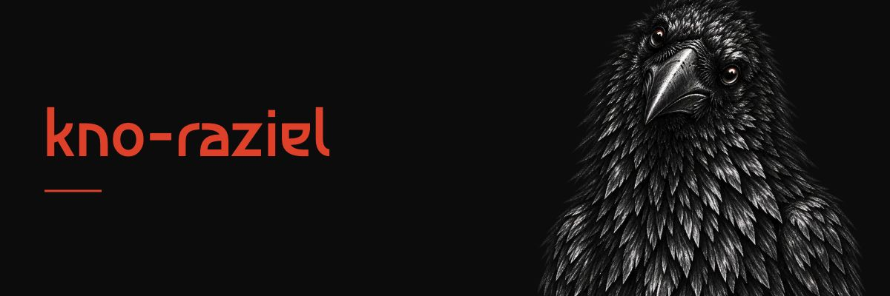

# Hi, I'm Victor.

I'm a software engineer based in Costa Rica. I build web applications and tools, and I write about the experiments behind them.

I like taking a problem apart, building something useful, and writing down what I learned. [Vagancia Project](https://vaganciaproject.com) is where I share that process, in English and Spanish.

*Observe. Investigate. Create.*

## Selected work

### [Vagancia Fitness](https://github.com/kno-raziel/vagancia-fitness)

*Created: October 2026*

A personal iPhone and Apple Watch project for treadmill workouts, health capture and Bluetooth diagnostics. It brings together native apps, a shared protocol core and local persistence. Available as source code to build locally.

Swift · SwiftUI · CoreBluetooth · HealthKit · SQLite

### [Sand Canvas](https://github.com/kno-raziel/sand-canvas)

*Started: February 25, 2026*

I built Sand as an open-source proof of concept for visual collaboration with AI coding agents, using real React components and MCP integration. The exercise helped me realize that my existing Storybook setup already covered my workflow, so I didn’t need Sand or Figma for my personal projects.

[Read how I reached that conclusion](https://vaganciaproject.com/blog/sand-poc/).

**Update:** In my latest projects, I’ve moved from Storybook to [React Cosmos](https://reactcosmos.org/). For my React-only workflow, its focus on isolated components is a better fit: fixtures are ordinary React components, so I can explore UI states and interactions using familiar code.

React · TypeScript · MCP · Zod

### [Spectral Curiosity](https://github.com/kno-raziel/spectral-curiosity)

*First commit: March 16, 2026*

I built Spectral to move away from Antigravity without leaving behind the AI-generated plans, documentation, and conversation context I wanted to keep. It brings artifact browsing, portable backups, and workspace recovery into a local tool that runs as a Bun app or a VS Code extension.

[Read why I built it](https://github.com/kno-raziel/spectral-curiosity#why-spectral).

React · TypeScript · Bun · SQLite

## How I work

I use coding agents for implementation, debugging and review. I guide the work with repository instructions, scoped tasks and acceptance criteria, then inspect the changes and verify behavior with tests. I care about understanding the decisions well enough to maintain what I build.

## Writing

At Vagancia Project I write about agentic development, software and the questions that come up while building. The publication is also a place to experiment with design and the web.

[Read in English](https://vaganciaproject.com) · [Leer en español](https://vaganciaproject.com/es/) · [LinkedIn](https://www.linkedin.com/in/victorcanohz/)
